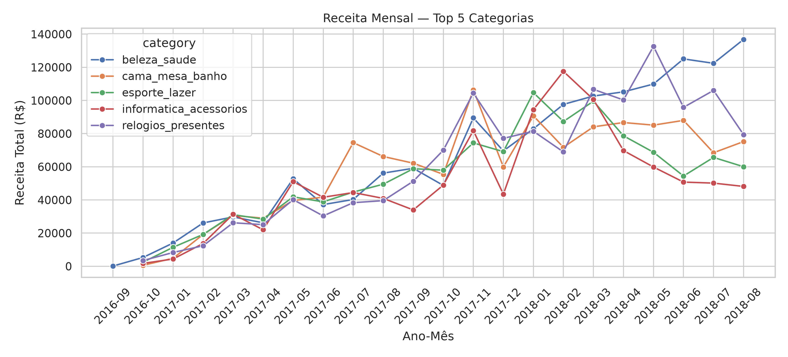
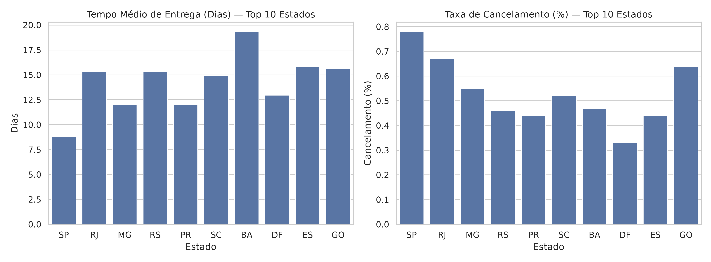
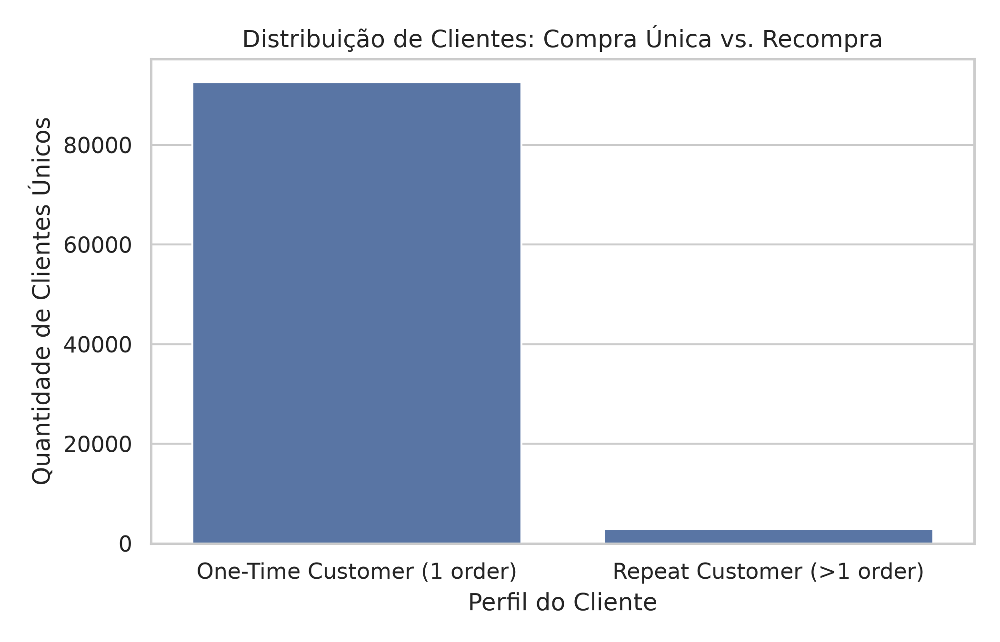
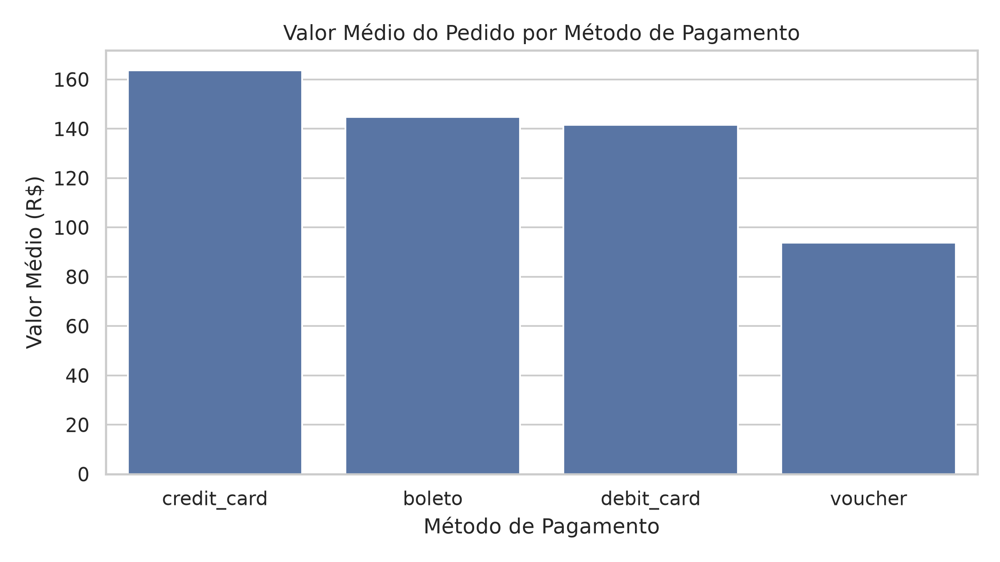

# E-commerce Sales & Customer Retention Analysis (Olist Dataset)

Projeto de análise de dados focado em vendas de e-commerce, logística, meios de pagamento e retenção de clientes utilizando o **Brazilian E-Commerce Public Dataset by Olist** (Kaggle). O objetivo é simular um fluxo de trabalho real de análise de dados, estruturando o banco relacional em SQLite, validando métricas de negócio via SQL e aprofundando a análise exploratória e visualizações em Python.

## Arquitetura e Estrutura do Repositório

```text
olist-sales-retention/
├── data/
│   └── raw/                             # Arquivos .csv originais do dataset (ignorados no Git)
├── images/                              # Gráficos exportados da análise exploratória
│   ├── 01_monthly_revenue_top_categories.png
│   ├── 02_delivery_cancel_by_state.png
│   ├── 03_customer_retention.png
│   └── 04_payment_avg_order_value.png
├── notebooks/
│   └── 01_exploratory_analysis.ipynb    # Análise exploratória, estatísticas e geração de gráficos
├── scripts/
│   └── load_db.py                       # Script automatizado de carga dos CSVs para SQLite
├── sql/
│   ├── 01_schema.sql                    # Definição das tabelas, chaves e relacionamentos
│   └── 02_queries.sql                   # Consultas SQL para as 4 perguntas de negócio
├── .gitignore
└── README.md
```

## Stack Tecnológica

* **Banco de Dados:** SQLite (`sqlite3`)
* **Linguagem e Análise:** Python 3, Pandas, Matplotlib, Seaborn
* **Ambiente e Versionamento:** VS Code, ambiente virtual (`.venv`), Git e GitHub

## Perguntas de Negócio e Principais Descobertas

### 1. Receita Mensal e Ticket Médio por Categoria
* A receita apresenta tendência de crescimento ao longo do período analisado, com picos sazonais marcantes (como em novembro de 2017) e forte tração de categorias como `beleza_saude` (`health_beauty`) na reta final.
* Categorias como `construction_tools_construction` e `watches_gifts` destacam-se por valores médios de pedido mais elevados no recorte avaliado.



### 2. Tempo de Entrega e Taxa de Cancelamento por Estado
* Nos pedidos entregues, o tempo de entrega apresenta **média de 12,56 dias**, **mediana de 10,22 dias** e **desvio padrão de 9,55 dias**, indicando assimetria puxada por entregas mais longas.
* Estados mais distantes geograficamente (como `RR`, `AP` e `AM` no geral, ou `BA` entre os Top 10 por volume) registram tempos médios de entrega mais altos, enquanto `SP` combina entrega mais rápida no recorte dos Top 10 com maior taxa proporcional de cancelamento (~0,78%) entre esses grandes volumes.



### 3. Retenção de Clientes (Recompra)
* Entre **95.560 clientes únicos** (`customer_unique_id`), **2.924** realizaram mais de uma compra, resultando em uma taxa de recompra de **3,06%**.
* Esse cenário reforça que a operação depende fortemente da aquisição de novos clientes e aponta uma oportunidade clara de ações de pós-venda e fidelização.



### 4. Comportamento por Método de Pagamento
* O valor total por pedido apresenta **média de R$ 160,99**, **mediana de R$ 105,29** e **desvio padrão de R$ 221,95**, refletindo distribuição assimétrica à direita.
* **`credit_card`** lidera tanto em volume de pedidos (**76.061**) quanto em valor médio (**R$ 163,61**), seguido por **`boleto`** (**R$ 144,85**), **`debit_card`** (**R$ 141,54**) e **`voucher`** (**R$ 93,79**).



## Como Executar o Projeto

1. **Clonar o repositório e ativar o ambiente virtual:**
   ```bash
   git clone [https://github.com/MullerJonathas/ecommerce-sales-customer-retention.git](https://github.com/MullerJonathas/ecommerce-sales-customer-retention.git)
   cd ecommerce-sales-customer-retention
   python3 -m venv .venv
   source .venv/bin/activate
   pip install pandas matplotlib seaborn jupyter ipykernel
   ```

2. **Colocar os arquivos CSV do dataset da Olist em `data/raw/` e gerar o banco `olist.db`:**
   ```bash
   python3 scripts/load_db.py
   ```

3. **Executar as consultas SQL (`sql/02_queries.sql`) e abrir o notebook (`notebooks/01_exploratory_analysis.ipynb`) no VS Code** utilizando o kernel do `.venv`.